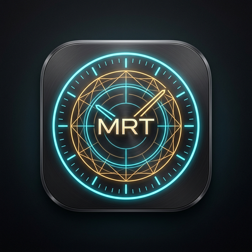

<div align="center">

  

  # MANAS
  **A tactile, distraction-free daily planner and thinking space built with Tauri 2.0 & Rust.**

  [](https://github.com/manas-app/manas/actions)
  [](LICENSE)
  [](https://tauri.app)
  [](https://www.rust-lang.org)
  [](#-100-private-local-first-architecture)

</div>

---

## 🧭 Philosophy

**Manas** (*Sanskrit for the sensory mind, contemplation, and inner purpose*) is an intentional daily rhythm planner designed for deep focus and structured clarity.

Unlike conventional bloated task apps that trap your life in proprietary databases, cloud subscriptions, or distracting notifications, Manas is:
* **100% Offline & Private**: Zero accounts, zero tracking, zero telemetry.
* **Instantaneous**: Starts in milliseconds with tiny RAM usage (~40MB).
* **Tactile**: Inspired by fine stationery, analog grids, and purposeful day structuring.
* **Your Data Forever**: Plain human-readable JSON files stored strictly on your local filesystem.

---

## 📦 Installation & Downloads

Pre-built binaries are available for every major platform on the **[Releases](https://github.com/manas-app/manas/releases)** page:

### 🐧 Linux
Download the `.deb` file (for Ubuntu/Debian) or the standalone `.AppImage`:
```bash
# Ubuntu / Debian / Mint
sudo dpkg -i manas_*_amd64.deb

# Any Linux (AppImage)
chmod +x manas_*_amd64.AppImage
./manas_*_amd64.AppImage
```

### 🍎 macOS
Download the `.dmg` (Universal binary supporting Apple Silicon M1/M2/M3 and Intel):
1. Open `manas_*_universal.dmg`.
2. Drag **Manas** into your `/Applications` folder.

### 🪟 Windows
Download and run `manas_*_x64-setup.exe` or `manas_*_x64.msi`.

---

## ✨ Core Features

* **Structured Daily Rhythm**: Dedicated phases for morning learning & foundation, midday work & operations, and structured evening tracks (*Huro, Kana, Bana / Curio, Survivo, Random*).
* **Decoupled Tasks & Scratchpads**: Every track contains an independent task checklist and a continuous reflection notepad.
* **Smart Task Reordering**: Move tasks up or down via dedicated controls, drag-and-drop handles, direct jump-to-rank dialog, or keyboard shortcuts (<kbd>Alt</kbd> + <kbd>↑</kbd> / <kbd>Alt</kbd> + <kbd>↓</kbd>).
* **365-Day Diary Navigator**: Full calendar jump, quick previous/next day browsing, and visual activity indicators.
* **Curated Tactile Themes**:
  * 📜 **Pure Paper**: Warm Moleskine cream for daylight writing.
  * 🌌 **Cyber Obsidian**: Deep black and glowing accents for late-night focus.
  * 🏺 **Ceramic Studio**: Sculpted cool-grey for tactile calm.
  * 🌲 **Forest Sage**: Organic muted greens for serene clarity.
* **Markdown Export**: One-click daily summary export to formatted Markdown.

---

## 🔒 100% Private, Local-First Architecture

All planner entries are stored on your local hard drive in simple, transparent JSON files:

| Operating System | Default Entry Storage Path |
| :--- | :--- |
| **Linux** | `~/.local/share/manas/entries/YYYY-MM-DD.json` |
| **macOS** | `~/Library/Application Support/manas/entries/YYYY-MM-DD.json` |
| **Windows** | `%APPDATA%\manas\entries\YYYY-MM-DD.json` |

* **Zero Lock-In**: You can back up, sync (via Git, Syncthing, or Dropbox), or script against your entries using any standard JSON tools.
* **Direct Access**: Click the **📁 folder icon** in the top navigation bar at any time to open your data folder directly in your system file manager.

---

## 🛠️ Development & Building from Source

### Prerequisites
- [Rust](https://rustup.rs/) (latest stable)
- [Node.js](https://nodejs.org/) (LTS)

### Quick Start
```bash
# Clone the repository
git clone https://github.com/manas-app/manas.git
cd manas

# Install frontend dependencies
npm install

# Run live development mode
npm run dev
```

### Build Native Release Binary
```bash
npm run build
# or directly via cargo:
cargo build --release --manifest-path src-tauri/Cargo.toml
```
The optimized native binary is output to `src-tauri/target/release/manas`.

---

## 🤝 Contributing

Contributions are warmly welcome! Please read [CONTRIBUTING.md](CONTRIBUTING.md) for details on our code of conduct, development setup, and pull request process.

---

## 📄 License

This project is licensed under the **MIT License** — see the [LICENSE](LICENSE) file for details.